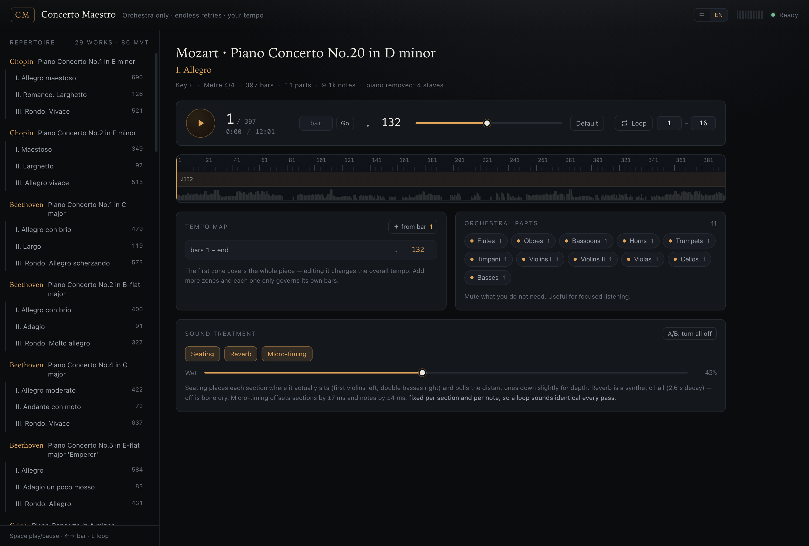

# Concerto Maestro

<p align="right">
  <a href="README.md"><kbd>简体中文</kbd></a> · <kbd>English</kbd>
</p>

> ### ⬇ [Download ConcertoMaestro-standalone.zip](https://github.com/a-musiclover/concerto-maestro/releases/latest/download/ConcertoMaestro-standalone.zip)　(17 MB)
>
> **Unzip → double-click `index.html` → practise.** Nothing to install, no network needed.
> Open it with Chrome or Edge; Safari has no sound.

A web page for piano students to rehearse concertos in private. **What plays is the orchestra with the piano taken out.** Tempo, sections and loops are yours. Practise it a hundred times; nobody is inconvenienced.




---

## Preface

> I know someone may take this and commercialise it. I genuinely welcome that — build on it, improve it, ship it. And if it ever makes real money, a share would be lovely (laughs).
>
> I'm a pianist and an AI practitioner. This is what I can offer: a small contribution to pianists everywhere, and a token of how much I love this art. I hope you'll use it in your daily practice and in your teaching.
>
> To borrow Fou Ts'ong's words: **"I am merely someone who spreads the gospel of music."**

---

## The problem

The hard part of learning a concerto is not the notes. It's that **there is no orchestra to rehearse with**.

The alternatives are: ask a friend to play the second piano (you owe them), listen to a recording (the tempo is fixed), wait for the one orchestra call per semester. All three are missing the same thing — **your tempo, starting at your bar, repeated a hundred times**.

That is the only thing this tool does.

## Run it

```bash
git clone <this repo>
cd concerto-maestro
pnpm install

pnpm run build:bank     # extract and prune the soundbank from your local MuseScore 4
pnpm run build
pnpm start              # http://127.0.0.1:5273/
```

## Give it to someone: the double-click build

**The download link for players is [Releases](https://github.com/a-musiclover/concerto-maestro/releases/latest)** — grab the 17 MB zip, unzip, double-click.

To rebuild it yourself:

```bash
pnpm run dist           # → ConcertoMaestro-standalone.zip (~17 MB)
```
Upload the zip to a release; the `releases/latest/download/` link always points at the newest one, so the README never needs editing.

Four things the browser kills on `file://`, and the workarounds:

| Killed | Workaround |
|---|---|
| ES modules | bundle as a classic IIFE script |
| `fetch()` of local JSON | compile each movement to `data/<id>.js`, inject via `<script>` |
| `fetch()` of local binary | base64-inline the soundbank, decode with `atob` |
| `AudioWorklet.addModule(blob:)` | **blob: URLs become `blob:null` (opaque origin) on file:// and Chrome refuses them.** Use `data:text/javascript;base64,` instead — data: has no origin |

That last one bites hardest: the error reads `AbortError: ... a dependency or cross-origin script failed to load`, which looks like a CORS problem but is really file:// having a null origin.

**Chrome / Edge only** for the offline build. Safari is stricter with `file://` and AudioWorklet usually refuses to start — run `pnpm start` locally instead.

## Repertoire

29 concertos, 86 movements:

**Chopin** 1–2 · **Beethoven** 1/2/4/5 (Emperor) · **Mozart** K37/39/40/41/175/413/450/456/466/467/482/491 ·
**Mendelssohn** 1 · **Grieg** · **Tchaikovsky** 1 · **Rachmaninoff** 1–2 · **Prokofiev** 2–3 ·
**Liszt** 1 · **Brahms** 2 · **Ravel** G · **Schumann**

Every movement is the full orchestral score minus the piano staves (identified by name and by the `{}` group in `%%score`).

## Soundbank

The repo ships **no** soundbank (size and licensing). The build extracts and prunes one from your local MuseScore 4:

```bash
pnpm run build:bank     # MS Basic.sf3: 48.9 MB → 16.2 MB
```

19 presets survive, with velocity layering intact (Cello / Timpani have 9 layers, the string sections 3).

Two traps worth recording:

1. **Filtering `presets` alone does nothing** (48.9 → 48.9 MB). The writer emits every entry in `instruments` and `samples` whether or not a preset still points at it. You have to walk the reachable set and rebuild both arrays.
2. **MS Basic keeps its velocity-layered strings off the GM violin programs** — they live at bank 20 / 25 / 30, program 48 (`Violins Fast` / `Violins2 Fast` / `Violas Fast`). A plain GM mapping silently picks the single-layer `Violin`. The player selects presets via bank select (CC0) + program change, and **only when the loaded bank actually has them**, so any other bank still works through the GM program baked into the track.

Loudness is calibrated: the pruned bank is quieter than the old GM one, so `BANK_TRIM` adds 1.54×; at equal loudness the mean RMS differs by 0.99×.

To try another bank: drop any `.sf2`/`.sf3` into `public/` and open with `?sf=filename` to A/B.

## The three switches

Pure code, not a byte of new samples:

| Switch | What it does | Measured |
|---|---|---|
| **Seating** | pans each section where it actually sits, pulls distant ones down for depth | first violins alone: L/R 0.98 (centred) → 1.85 (clearly left) |
| **Reverb** | a synthetic hall (2.6 s decay, decorrelated stereo + early reflections), wet/dry adjustable | 1.5 s after pause the tail is still 0.016 → 0.003; off drops to 0.0001 instantly |
| **Micro-timing** | ±7 ms between sections, ±4 ms between notes | sections land at −6…+6 ms, identical on every call |

The third one is **deterministic** on purpose: offsets are derived from the section name and the note index, so a loop sounds identical every pass. True randomness makes the same phrase different each time, which is worse, not better, when you are drilling.

## Engine

**Tempo is data, not a render result.** A "tempo zone" is just `{from bar, bpm}`; bar lengths, total duration and the playhead are all derived from it. Dragging the tempo slider re-renders nothing, bends no pitch and leaves no seam.

Scheduling is [`spessasynth_lib`](https://github.com/spessasus/spessasynth_lib) (SF2/SF3 inside an AudioWorklet) used purely as a synthesiser. We keep our own timeline and hand it notes with explicit `AudioContext` timestamps 280 ms ahead.

## The build pipeline

`scripts/build.mjs`: **ABC → baked JSON**, so the browser only has to play. The source transcriptions are impressively messy:

| Problem | Handling |
|---|---|
| piano and orchestra mixed in a 28-voice score | split **each voice out and parse it alone**, then classify by `nm=`; the `{}` group in `%%score` is the piano |
| transposing instruments (horn in E, trumpet in D) | apply the `transpose=` on the `V:` line |
| clef changes written as `[K:treble]` | recognise and drop them — they otherwise reset the key signature |
| triplets | abcjs reports unscaled durations, so triplet bars come out long; force each bar back to the metre |
| `[K:]`/`[M:]` changes mid-movement | split into segments, parse separately, keep bar numbering continuous |
| `I:percmap` truncating the header | accept any `Letter:` line in the header scan |
| `Vln. 2` / `Vc. 1` / `Roial'` / `Skripki` | a matcher that knows the abbreviations and the Cyrillic transliterations |
| the body's opening `V:1` being eaten as a duplicate declaration | **silently dropped the entire first voice of every piece.** Fixed by rewinding one line |
| `[Q:]` tempo marks | **not extracted.** They cluster in one voice and contradict each other; tempo is yours |

## Known limitations (all real)

- **Repeats are not expanded.** `|:` is treated as a plain barline, so movements with repeats come out short.
- **Some transcriptions are themselves broken.** Tchaikovsky 1/I is 1140 bars / 57 minutes — repeated passages were written out. The `measure count differs across voices` warning in the build log flags these.
- **Only timpani survives from the percussion.** Unpitched percussion dumped into a GM drum channel becomes noise.
- **Strings are single-line.** ABC has one line per voice, so divisi is flattened; sections sound thinner than a real orchestra. A format ceiling, not a bug.
- **Tempo zones are per-bar; no accelerando or ritardando.**
- **Browsers have a memory ceiling.** `decodeAudioData` produces Float32 (352 KB per second of stereo), so large sample libraries do not fit.

## What I want to do next

By value per unit of work:

1. **Articulation** (short notes → staccato, repeats → tremolo). Every staccato in the score is currently stretched into a legato note — the last big piece of "fake".
2. **Pedal / page-turner bindings** (PageUp, arrows) so you never leave the piano.
3. **Piano entry markers** — turn the removed piano part into marks on the bar ruler that tell you where you come in.
4. **Audio export**, for practising from a phone.

## Licence

Code is released under **CC BY-NC 4.0** — see [LICENSE](LICENSE).

In short: fork it, use it, pass it on, don't sell it. If you build something real on top of it, I'd genuinely love to hear about it.

## Third-party material and provenance

- **Soundbank**: pruned from MuseScore 4's `MS Basic.sf3`. Not included in the repo; built from your local copy. Check MuseScore's asset terms before redistributing.
- **Scores**: the ABC transcriptions are OMR output from IMSLP scans, processed by this project's pipeline into `public/pieces/*.json`. The works themselves are largely public domain, but **the rights in a specific transcription or edition are your call** — verify before any commercial use.
- **Engine**: [spessasynth_lib](https://github.com/spessasus/spessasynth_lib) (Apache-2.0), [abcjs](https://github.com/paulrosen/abcjs) (MIT).
- No commercial sample libraries and no recordings are included.

## Layout

```
public/                ← deployable static output
  index.html  app.js  app.css
  pieces/              ← baked movement JSON + index.json
  soundfont.sf3        ← generated, gitignored
  spessasynth_processor.min.js
src/
  main.js   UI wiring, bar ruler
  player.js scheduler, mixer, sound treatment
  tempo.js  tempo map
  i18n.js   zh/en strings
scripts/
  build.mjs            ABC → JSON
  build-bank.mjs       soundbank pruning
  build-standalone.mjs offline bundle
  serve.mjs            zero-dependency static server
  catalog.json         the repertoire list — the only hand-maintained file
```

---

## Last but not least

Thanks to **DSH** (DeepSeek Harness) for the tireless coding — from the voice-dropping traps in the ABC parser, through the scheduler and the soundbank pruning, to the three sound-treatment switches. It was there for every line.

And do give China's open-source **DeepSeek** models a try (laughs).
