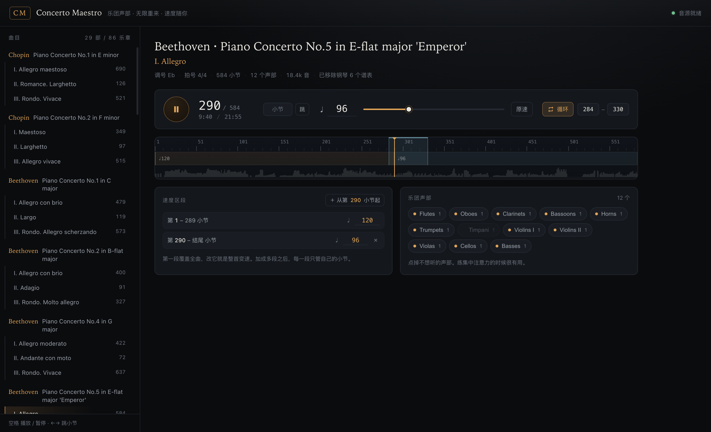

# Concerto Maestro

> 给钢琴系学生私下练协奏曲用的网页：**放的是去掉钢琴的乐团**。速度、段落、循环都由你定，练一百遍也不用跟任何人客气。



---

## 前言

> 我知道也许有人会把这个产品拿去商业化，我非常欢迎你们在已经的基础上进行修改并完善，如果挣大钱了，能给我一些分红那是再好不过的了（笑）。
>
> 这个产品我作为钢琴演奏者和人工智能从业者，代表了我对钢琴艺术的热爱，以及我为全球所有钢琴演奏者能做一些的一些微小贡献。希望你们能在日常的练习、教学中使用到它。
>
> 借用傅聪老爷子的话说：**"我只是为音乐传福音的人罢了。"**

*[English →](README.en.md)*

---

## 它解决什么

练协奏曲最大的现实问题不是弹不好，是**没有乐团陪你**。

替代方案只有三个：找同学弹第二钢琴（欠人情）、听录音（速度是死的）、等乐队合排（一学期几次）。这三条都缺同一件事——**能按你的速度、从你要的小节开始、重来一百遍**。

这个工具就干这一件事。

## 跑起来

```bash
git clone <this repo>
cd concerto-maestro
pnpm install

pnpm run build:bank     # 从本机 MuseScore 4 提取并裁剪音源（见下）
pnpm run build          # 打包前端
pnpm start              # http://127.0.0.1:5273/
```

## 发给别人：解压就能用的版本

```bash
pnpm run dist           # → ConcertoMaestro-standalone.zip（约 17 MB）
```

对方解压 → 双击 `ConcertoMaestro/index.html` → 完事。**不需要服务器、不需要装任何东西、不需要联网。**

### `file://` 下要绕的四个坑

| 被浏览器干掉的东西 | 绕法 |
|---|---|
| ES module | 打包成 IIFE 经典脚本 |
| `fetch()` 读本地 JSON | 每个乐章编译成 `data/<id>.js`，用 `<script>` 注入 |
| `fetch()` 读本地二进制 | 音源 base64 内嵌，`atob` 还原 |
| `AudioWorklet.addModule(blob:)` | **blob: URL 在 file:// 下变成 `blob:null`（opaque origin），Chrome 直接拒绝。** 改用 `data:text/javascript;base64,`——data: 没有 origin，Chrome 照吃 |

最后一条最容易卡住：报错是 `AbortError: ... a dependency or cross-origin script failed to load`，看着像跨域，其实是 file:// 的 origin 是 null。

**只用 Chrome / Edge。** Safari 对 `file://` 的限制更严，AudioWorklet 大概率起不来——那就在本地跑 `pnpm start`。

## 曲库

29 部协奏曲、86 个乐章：

**Chopin** 1–2 · **Beethoven** 1/2/4/5(Emperor) · **Mozart** K37/39/40/41/175/413/450/456/466/467/482/491 ·
**Mendelssohn** 1 · **Grieg** · **Tchaikovsky** 1 · **Rachmaninoff** 1–2 · **Prokofiev** 2–3 ·
**Liszt** 1 · **Brahms** 2 · **Ravel** G · **Schumann**

每个乐章都是**完整总谱**里除钢琴以外的所有声部（钢琴谱表按名字和 `%%score` 的花括号组剔掉）。

## 音源

仓库里**不含音源文件**（体积 + 许可原因）。构建时从你本机的 MuseScore 4 提取并裁剪：

```bash
pnpm run build:bank     # MS Basic.sf3: 48.9 MB → 16.2 MB
```

保留 19 个 preset，力度分层完好（Cello / Timpani 9 层，弦乐声部 3 层）。

裁剪时有两个坑，记在这里省得别人再踩：

1. **只过滤 `presets` 完全没用**（48.9 → 48.9 MB）。写入器会把 `instruments` 和 `samples` 里的每一条都写出去，不管还有没有 preset 指向它。必须自己走一遍「可达集合」，再重建这两个数组。
2. **MS Basic 带力度层的弦乐不在 GM 的 violin program 上**，而在 bank 20 / 25 / 30 的 program 48（`Violins Fast` / `Violins2 Fast` / `Violas Fast`）。照 GM 直接映射会拿到单层的 `Violin`。播放器按 bank select（CC0）+ program change 选预设，并且**只在音源里确实存在时才用**，换别的库会自动退回 track 自带的 GM program。

响度做了校准：裁剪后的库比原来的 GM 库安静，`BANK_TRIM` 补偿 1.54×，等响度下平均 RMS 差 0.99×。

想换别的音源：往 `public/` 丢任意 `.sf2`/`.sf3`，然后用 `?sf=文件名` 打开即可 A/B。

## 三个音色开关

纯代码，不需要新音源：

| 开关 | 做什么 | 实测 |
|---|---|---|
| **声部摆位** | 按乐团实际座位给每个声部 pan（Vln I 在左、低音提琴在右），远处声部压低一点做纵深 | 只留第一小提琴：L/R 从 0.98（正中）→ 1.85（偏左） |
| **混响** | 合成厅（2.6 秒衰减，去相关立体声 + 早期反射），干湿可调 | 暂停后 1.5 秒仍有 0.016 → 0.003 的尾巴；关掉瞬间 0.0001 |
| **演奏微时序** | 声部间 ±7ms、音符间 ±4ms 的偏移 | 各声部 −6…+6ms，重复调用完全一致 |

第三条的关键是**确定性**：偏移由声部名和音符序号算出来，循环同一段时每一遍都一样。真随机会让同一个乐句每遍不同，练琴时反而更难受。

## 引擎

**速度是数据，不是渲染结果。** 一个「速度区段」就是 `{从第几小节, 多少 bpm}`；小节长度、总时长、播放头位置全由它算出来。所以拖速度滑块不重新渲染、不变调、没有拼接缝。

调度用 [`spessasynth_lib`](https://github.com/spessasus/spessasynth_lib)（SF2/SF3 跑在 AudioWorklet 里）当纯合成器，自己做时间轴，提前 280 ms 把音符带着 `AudioContext` 时间戳递进去。

## 构建管线

`scripts/build.mjs`：**ABC → 烘焙 JSON**，浏览器只负责播放。这套 IMSLP 转谱脏得很有想象力：

| 问题 | 处理 |
|---|---|
| 28 声部总谱里钢琴和乐团混在一起 | 按 `V:` 把每个声部**单独切出来解析**，再按 `nm=` 认乐器；`%%score` 的 `{}` 组是钢琴 |
| 移调乐器（圆号 in E、小号 in D） | 读 `V:` 的 `transpose=` 手动加 |
| 谱号变化写成 `[K:treble]` | 认出并丢弃——它会让调号被误重置 |
| 三连音 | abcjs 报的是未缩放时值，三重音小节会算长；按拍号把每小节拉回正确长度 |
| 乐章内的 `[K:]`/`[M:]` 变化 | 切段分别解析，小节号跨段连续 |
| `I:percmap` 截断表头 | 表头扫描放宽到任意 `字母:` 行 |
| `Vln. 2` / `Vc. 1` / `Roial'` / `Skripki` | 带缩写和俄文转写的乐器名匹配表 |
| 体部首行的 `V:1` 被当重复声明吃掉 | **导致每条曲子第一声部整条丢失**。回退一行修掉 |
| `[Q:]` 速度标记 | **不抽**。它们挤在一个声部里还互相矛盾，抽出来是错的。速度归你 |

## 已知的问题（都是真的）

- **反复记号不展开。** `|:` 只当普通小节线，带反复的乐章会比谱面短。
- **个别转录本身有问题。** Tchaikovsky 1 第一乐章 1140 小节 / 57 分钟，是重复段落写进去了。构建日志里 `measure count differs across voices` 就是在提示这类。
- **打击乐只留定音鼓。** 无音高打击乐硬塞进 GM 打击通道会变成噪音。
- **弦乐是单线。** ABC 一个声部只有一条线，谱面的 divisi 被压扁，所以比真乐团薄。这是格式上限。
- **速度区段按小节切，做不了渐快渐慢。**
- **浏览器内存有上限。** `decodeAudioData` 出来是 Float32（立体声 352 KB/秒），几百 MB 就是硬天花板，所以塞不进大型采样库。

## 接下来想做的

按性价比排：

1. **弓法**（短音 → staccato、重复 → tremolo）。现在谱面上所有断奏都被拉成了连音，这是「假」的最后一大块。
2. **踏板/翻页器绑定**（PageUp / 方向键），练琴时不用起身。
3. **钢琴进拍标记**——把被删掉的钢琴声部变成小节尺上的记号，告诉你「我这儿进」。
4. **导出音频**，手机上离线练。

## 许可

代码以 **CC BY-NC 4.0** 发布，见 [LICENSE](LICENSE)。

简单说：**随便改、随便用、随便传，别拿去卖。** 如果你真的基于它做成了什么，非常欢迎告诉我（笑）。

## 第三方素材与来源

- **音源**：裁剪自 MuseScore 4 的 `MS Basic.sf3`。仓库不含音源文件，构建时从本机提取；再分发请自行确认 MuseScore 资产的使用条款。
- **乐谱**：ABC 转录来自 IMSLP 扫描件的 OMR 转录，经本项目管线处理成 `public/pieces/*.json`。曲目本身基本在公有领域，但**具体转录与编配版本的权属需自行判断**，商业使用前请核实。
- **引擎**：[spessasynth_lib](https://github.com/spessasus/spessasynth_lib)（Apache-2.0）、[abcjs](https://github.com/paulrosen/abcjs)（MIT）。
- 本项目不包含任何商业采样库，也不包含任何录音。

## 目录

```
public/                ← 可直接部署的静态产物
  index.html  app.js  app.css
  pieces/              ← 烘焙好的乐章 JSON + index.json
  soundfont.sf3        ← 构建生成，不入库
  spessasynth_processor.min.js
src/
  main.js   UI 接线、小节尺绘制
  player.js 调度器 + 混音 + 音色处理
  tempo.js  速度映射
  i18n.js   中英文文案
scripts/
  build.mjs           ABC → JSON
  build-bank.mjs      音源裁剪
  build-standalone.mjs 离线包
  serve.mjs           零依赖静态服务器
  catalog.json        曲目清单（唯一需要人工的地方）
```
